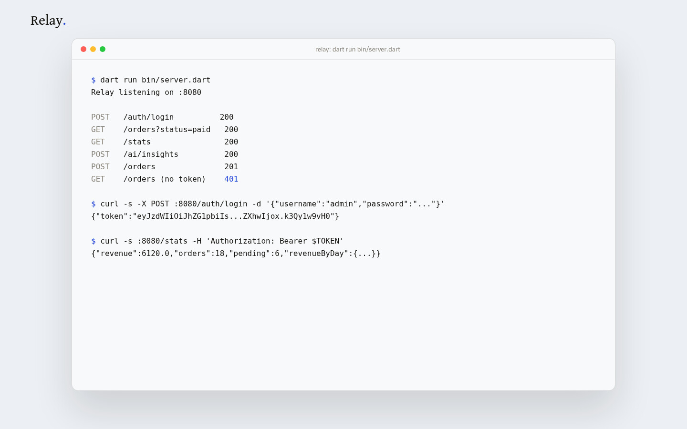

# Relay: Dart REST backend (shelf) with roles, orders, customers, webhooks and an AI proxy

A backend written in **Dart** with **shelf** and **shelf_router**. It is the shared backend for the **Pulse** Flutter Web dashboard and the **Focus Desk** Flutter desktop app.

**Tech:** Dart, shelf, shelf_router, REST API, bearer-token auth (HMAC) with roles, pagination and filtering, signed webhooks with retries, rate limiting, CORS, JSON file store, OpenAI API proxy with offline fallback, Docker.

## Endpoints
All routes except `/health` and `/auth/login` need `Authorization: Bearer <token>`. Write methods need the `admin` role.

| Method | Path | Notes |
|---|---|---|
| GET | /health | open, returns version |
| POST | /auth/login | `{username,password}` returns `{token, role}` |
| GET | /auth/me | current user and token expiry |
| GET | /orders | `status`, `q`, `customer_id`, `min_amount`, `max_amount`, `from`, `to`, `sort`, `page`, `per_page` |
| GET | /orders/export.csv | same filters, CSV download |
| GET | /orders/:id | items, note and status history |
| POST | /orders | `{customerId, items:[{sku,name,qty,price}], status?, note?}` |
| PATCH | /orders/:id | `{status?, note?}`, records who changed it |
| POST | /orders/bulk-status | `{ids:[...], status}` |
| DELETE | /orders/:id | |
| GET | /customers | `q`, `tag`, `city`, `sort`, paging; includes order count and lifetime value |
| GET | /customers/:id | with recent orders |
| POST, PATCH, DELETE | /customers[/:id] | email validation, duplicate check, delete blocked when orders exist |
| GET | /stats | revenue, average order, status breakdown, top customers and products, `from`/`to` |
| POST | /ai/insights | summary of stats; the API key stays on the server |
| GET, POST, DELETE | /focus/sessions | tags, paging, used by Focus Desk |
| GET | /focus/stats | totals by day and tag, streak in days |
| GET, POST, PATCH, DELETE | /webhooks | subscribe to `order.created`, `order.updated`, `order.deleted`, `session.created` or `*` |
| POST | /webhooks/:id/test | sends a signed `ping` |
| GET | /webhooks/deliveries | attempt log |
| GET | /admin/audit, /admin/users | admin only |

Paging info is returned in headers (`x-total-count`, `x-page`, `x-per-page`, `x-total-pages`), so list bodies stay plain JSON arrays.

### Webhook signatures
Each delivery sends `x-relay-event` and `x-relay-signature: sha256=<hex HMAC of the raw body>` using the secret returned when the webhook was created. Failed deliveries are retried 3 times with exponential backoff.

### Rate limiting
120 requests per minute per caller by default (`RATE_LIMIT`). Responses carry `x-ratelimit-limit`, `x-ratelimit-remaining` and `x-ratelimit-reset`. Over the limit returns `429` with `retry-after`.

## Run
```bash
dart pub get
ADMIN_USER=admin ADMIN_PASS=admin123 TOKEN_SECRET=change-me dart run bin/server.dart
dart test
docker build -t relay . && docker run -p 8080:8080 relay
```
Seeded users: the admin from the env vars and a read-only `viewer` / `viewer123`. Optional: set `OPENAI_API_KEY` for real AI summaries. Without it the endpoint returns a rule-based summary.

## Layout
```
lib/models/       Customer, Order, OrderItem, FocusSession, User, WebhookSub, AuditEntry
lib/routes/       orders, customers, webhooks, focus, admin
lib/middleware/   auth guard and roles, rate limiter, request id
lib/services/     webhook dispatcher
lib/store.dart    JSON-file persistence behind one class
test/             auth, orders, customers, webhooks, rate limit, focus, AI proxy
```

## Honest status
- The code was written without running it. Run `dart analyze` and `dart test` first.
- The JSON file store and token auth are simple by design. A production version needs a real database, a slow password hash (argon2 or bcrypt) and a standard JWT library.
- Screens below are design mockups, not recordings.

## Screens (design mockups)

