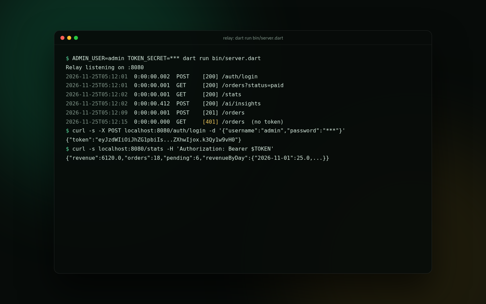

# Relay: Dart REST backend (shelf) with auth, orders and an AI proxy

Personal demo project. A small backend written in **Dart** with **shelf** and **shelf_router**. It is the shared backend for three other demos: the **Pulse** Flutter Web dashboard, the **Ledgerline** Dart CLI and the **Focus Desk** Flutter desktop app.

**Tech:** Dart, shelf, shelf_router, REST API, bearer-token auth (HMAC), CORS, JSON file store, OpenAI API proxy with offline fallback, Docker.

## Endpoints
| Method | Path | Notes |
|---|---|---|
| GET | /health | open |
| POST | /auth/login | `{username,password}` returns `{token}` |
| GET | /orders | filters `?status=` and `?q=` |
| POST | /orders | `{customer, amount, status?}` |
| PATCH | /orders/:id | `{status}` |
| GET | /stats | revenue, order count, pending, revenue by day |
| POST | /ai/insights | summary of stats; the API key stays on the server |
| GET, POST | /focus/sessions | used by Focus Desk |

All routes except `/health` and `/auth/login` need `Authorization: Bearer <token>`.

## Run
```bash
dart pub get
ADMIN_USER=admin ADMIN_PASS=admin123 TOKEN_SECRET=change-me dart run bin/server.dart
dart test
docker build -t relay . && docker run -p 8080:8080 relay
```
Optional: set `OPENAI_API_KEY` for real AI summaries. Without it the endpoint returns a rule-based summary.

## Honest status
- The code was written without running it. Run `dart analyze` and `dart test` first.
- The JSON file store and token auth are demo-grade. A production version needs a real database, hashed passwords and a standard JWT library.

## Screens (design mockups, not recordings)

